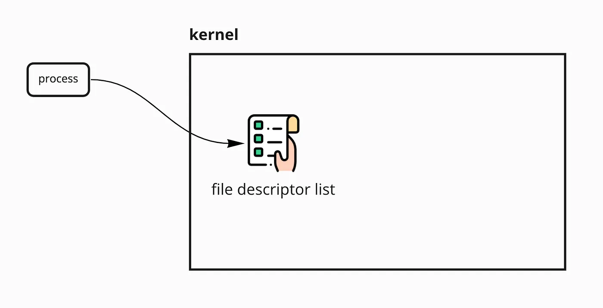
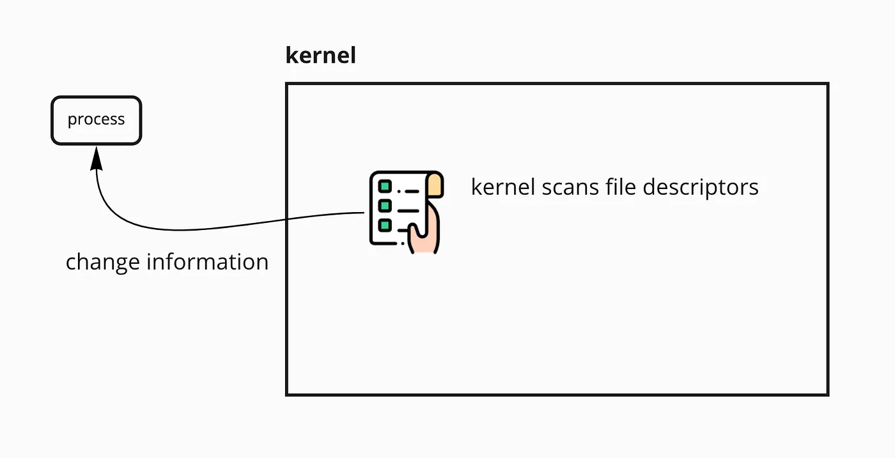
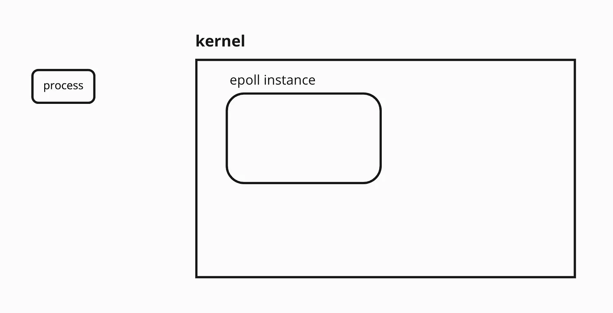
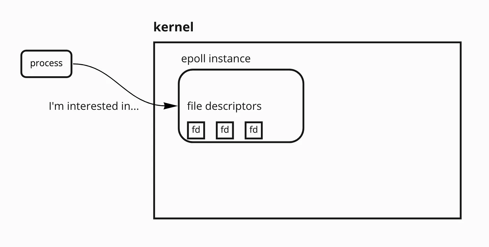
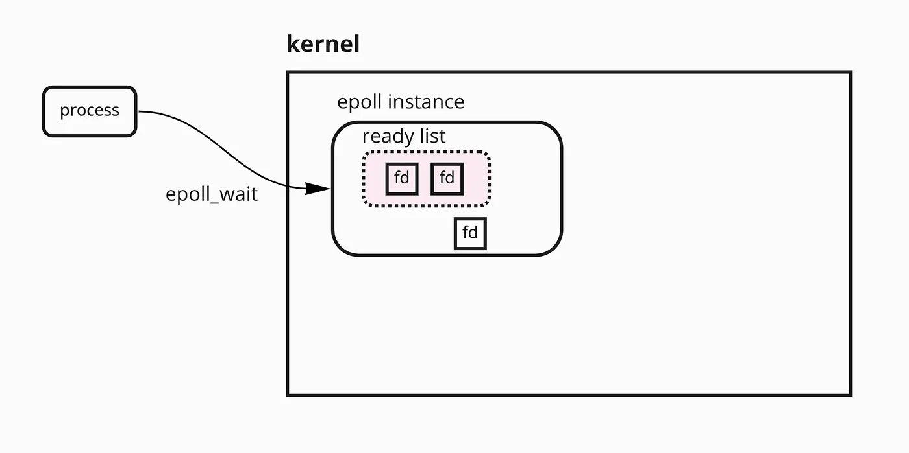

*This project has been created as part of the 42 curriculum by oel-hadr, yslami*

## 📖 Description
**Webserv** is a high-performance HTTP web server written in **C++98**. Inspired by the architecture of **Nginx**, this project explores the low-level mechanics of the World Wide Web. By building a server from scratch using sockets, we've implemented a system capable of serving static content, handling file uploads, and executing dynamic scripts via CGI.

The core of Webserv is a **non-blocking I/O multiplexing engine**, ensuring that a single process can handle hundreds of concurrent connections without hanging or crashing.


## Technical Choices: Why `epoll()`?

The heart of a high-performance web server lies in its ability to handle thousands of simultaneous connections without idling. While the project requirements allow for the use of `select()`, `poll()`, or `kqueue()`, we chose **`epoll()`** as our primary I/O multiplexing mechanism. To understand this choice, one must analyze the structural limitations of its predecessors.


### The Legacy: `select()` and `poll()`

Historically, `select()` and `poll()` were the standard tools for monitoring multiple file descriptors (FDs). However, they suffer from a fundamental design flaw: **Linear Scalability.**

<center></center>
<center>select or poll request to the kernel</center>

<center></center>
<center>return changed fd information by the kernel</center>

#### The User-Kernel Context Switch

Both `select()` and `poll()` require the application to pass a complete list of all monitored file descriptors from **User Space** to **Kernel Space** every single time the function is called.

* **The Prototype :** `int select(int nfds, fd_set *readfds, ...)` or `int poll(struct pollfd *fds, nfds_t nfds, ...)`.
* **The Iteration Problem:** After the kernel determines which sockets are ready, the application must iterate through the *entire* list of FDs to find which ones actually changed.
* **The Cost:** If you are monitoring 10,000 connections but only 1 is active, the CPU still performs $O(N)$ operations, wasting cycles on 9,999 idle sockets.

---

### The Modern Standard: `epoll()` Deep Dive

`epoll()` was designed to eliminate the $O(N)$ overhead by shifting the "bookkeeping" of file descriptors from the user application to the kernel's internal data structures. It functions through a three-stage lifecycle:

#### 1. `epoll_create1()` – The Interest List

Instead of creating a list every loop, we call `epoll_create1()` once. This creates an **epoll instance** (an opaque kernel object) represented by a single file descriptor. Inside the kernel, this instance maintains an **Interest List** a Red-Black Tree containing all the FDs we want to monitor.

<center></center>
<center>creates an epoll instance</center>

#### 2. `epoll_ctl()` – Decoupling Registration from Monitoring

Unlike `poll()`, where you send the whole list every time, `epoll_ctl()` allows us to add, modify, or remove specific FDs from the Interest List only when a client connects or disconnects. This means we only "talk" to the kernel about a specific socket once, drastically reducing the data transferred between User and Kernel space.

<center></center>
<center>add, modify, or remove specific FD</center>

#### 3. `epoll_wait()` – The Ready List and Event-Triggering

This is where the magic happens. When an event occurs on a monitored socket (like an incoming GET request), the kernel places that FD into a **Ready List**.

* **Constant Time:** `epoll_wait()` only returns the FDs that are actually ready. If 10,000 clients are connected but only 5 sent data, `epoll_wait()` returns exactly 5 events.
* **Efficiency:** The complexity is reduced to $O(\text{number of ready events})$, making it effectively $O(1)$ relative to the total number of connections.


<center></center>
<center>returns the FDs that are actually ready</center>


---

### The Evolution of Multiplexing

In our implementation, we leverage a **single poll loop** to drive all I/O, including the listening socket and client pipes for CGI. By using `epoll()`, our server remains responsive even during the heavy stress testing required by the subject. We ensure that no read or write operation occurs without prior readiness notification from the kernel, satisfying the strict non-blocking requirements of the 42 curriculum.

| Feature | `select()` / `poll()` | `epoll()` |
| :--- | :--- | :--- |
| **Complexity** | $O(N)$ - Scans all file descriptors every loop. | $O(1)$ - Only returns active events. |
| **Efficiency** | Slows down as the number of clients increases. | Performance remains constant regardless of load. |
| **Data Transfer** | Copies the FD list from User to Kernel space every call. | Uses a shared event list in the kernel. |

**Our Logic:** `epoll` is "event-triggered." Instead of the server asking 1,000 sockets "Do you have data?", the Kernel gives the server a specific list of only the sockets that are ready to be read or written. This prevents the "thundering herd" problem and keeps our server responsive under heavy stress tests.

## The Lifecycle of a Request:

To understand how Webserv works, let's look at what happens when a user visits `gmail.com` to see their inbox:

1. **The Request (User Agent):** Your browser (the Client) opens a socket and sends an HTTP `GET /inbox` request.
2. **The Connection:** Our server's `epoll` loop detects a new connection on the listening port. We `accept()` the connection and set the socket to `O_NONBLOCK`.
3. **Parsing:** We read the raw text from the socket. We check the `Host` header to see which "Virtual Server" should handle the request.
4. **Processing (CGI):** Since the inbox is dynamic, Webserv `fork()`s a **CGI process** (e.g., Python or PHP). The CGI fetches the emails from a database and returns HTML.
5. **The Response:** Our server wraps this data in an HTTP/1.1 200 OK header and sends it back to the browser.
6. **Rendering:** Your browser receives the HTML and displays your emails.


## Features

- **Non-blocking Architecture:** Uses a single `epoll()` instance for all I/O operations (Listen, Read, Write).
- **CGI Support:** Full support for chunked requests and EOF handling for dynamic scripts.
- **Configurable Routes:** Nginx-like configuration for redirects, directory listing, and custom error pages.
- **File Management:** Native support for `POST` (uploads) and `DELETE` methods.
- **Resilience:** Designed to never crash, even under total memory exhaustion.


## Getting Started

### 1. Compilation
The project requires a **C++98** compliant compiler.
```sh
make
```

### 2. Configuration

Define your server behavior in a .conf file. You can set up multiple ports and roots:

```nginx
server {
    listen 8080;
    server_name example.com;
    root ./www;
    index index.html;
    
    location /upload {
        accepted_methods POST;
        upload_store ./uploads;
    }
}
```

### 3. Execution

```sh
./webserv path/to/your_config.conf
```

## Resources & AI Usage

### Resources

The development of **Webserv** required a deep dive into Unix networking, the HTTP/1.1 protocol, and the intricacies of non-blocking I/O. The following curated list represents the foundational documentation, RFCs, and technical deep-dives that guided our architectural decisions and helped us navigate the complexities of socket programming and CGI implementation.

#### Core Documentation & RFCs

* **RFC 2616 (HTTP/1.1):** The primary reference for protocol compliance and message formatting. 
* **RFC 3875 (The CGI/1.1 Specification):** [Essential for implementing the Common Gateway Interface correctly](https://www.rfc-editor.org/rfc/rfc3875). 
* **MDN Web Docs:** [Comprehensive guide on HTTP Messages](http://developer.mozilla.org/en-US/docs/Web/HTTP/Guides/Messages). 

#### Network Programming & I/O Multiplexing

* **Beej's Guide to Network Programming:** [The gold standard for Berkeley Sockets](https://beej.us/guide/bgnet/html/#cb30-2).
* **Unix Network Programming (UNP) Notes:** [Detailed breakdown of I/O Models](https://notes.shichao.io/unp/ch6/).
* **Mastering `epoll`:** [High-performance Linux networking internals](https://medium.com/@m-ibrahim.research/mastering-epoll-the-engine-behind-high-performance-linux-networking-85a15e6bde90).
* **Demystifying `select`/`poll`:** [Understanding kernel internals and the C10K challenge](https://medium.com/%40m-ibrahim.research/demystifying-select-poll-kernel-internals-and-the-c10k-challenge-6f3f5b5cd632).
* **Non-blocking I/O Strategies:** [An in-depth look at asynchronous design patterns](https://copyconstruct.medium.com/nonblocking-i-o-99948ad7c957).

### Server Architecture & Tutorials

* **TCP Listen - A Tale of Two Queues:** [Understanding the SYN and Accept queues](https://arthurchiao.art/blog/tcp-listen-a-tale-of-two-queues/).
* **Nginx Selection Algorithms:** [Understanding how Nginx handles server and location blocks](https://www.digitalocean.com/community/tutorials/understanding-nginx-server-and-location-block-selection-algorithms).
* **CGI Tutorial:** [A historical but vital guide to CGI-bin communication](https://web.archive.org/web/20230612082452/http://www.whizkidtech.redprince.net/cgi-bin/tutorial).

### AI Usage

- **TESTING:** Assisted in generating Python scripts for stress-testing the server's resilience.
